# ARDF

This is a fork of [Armels Quansheng Firmware](https://github.com/armel/uv-k1-k5v3-firmware-custom/) to add ARDF support for UV-K5 V3 and UV-K1 radios.

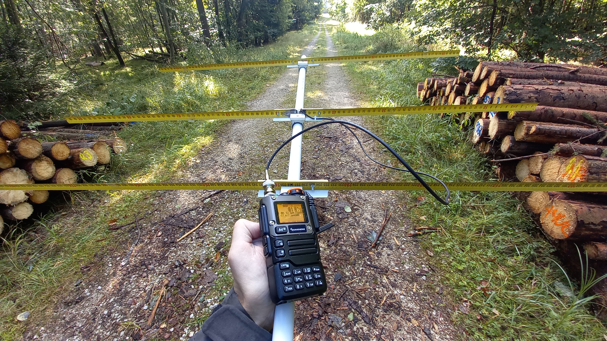


## Table of Contents

* [Main ARDF Features](#main-ardf-features)
* [Compatible Devices](#compatible-devices)
* [ARDF Feature Manual](#ardf-feature-manual)
* [Firmware Flashing](#firmware-flashing)
* [Headphones](#headphones)
* [Antenna Proposals](#antenna-proposals)
* [Compiling and Building from Docker](#compiling-and-Building-from-docker)
* [Flashing the Firmware with UVTools2](#flashing-the-firmware-with-uvtools2)
* [Credits](#credits)
* [License](#license)

## Main ARDF features:

* AM demodulation
* Manual gain control
* Transmission function completely disabled (safe for non ham radio licenced operators!)
* Active fox and remaining cycle time display
* Beep signal before end of fox cycle
* Fox distance prediction
* Simplified mode for [Draussenfuchs](https://draussenfuchs.de)

## Compatible Devices

> [!WARNING]
> There are **different UV-K5 hardware versions out**. **Check carefully** which hardware version do you have **before flashing** any new firmware!

:exclamation: All versions have different processors and need the right firmware and flash tool to run. :exclamation:

> The hardware version of a device usually can be found on the label under the battery:
> 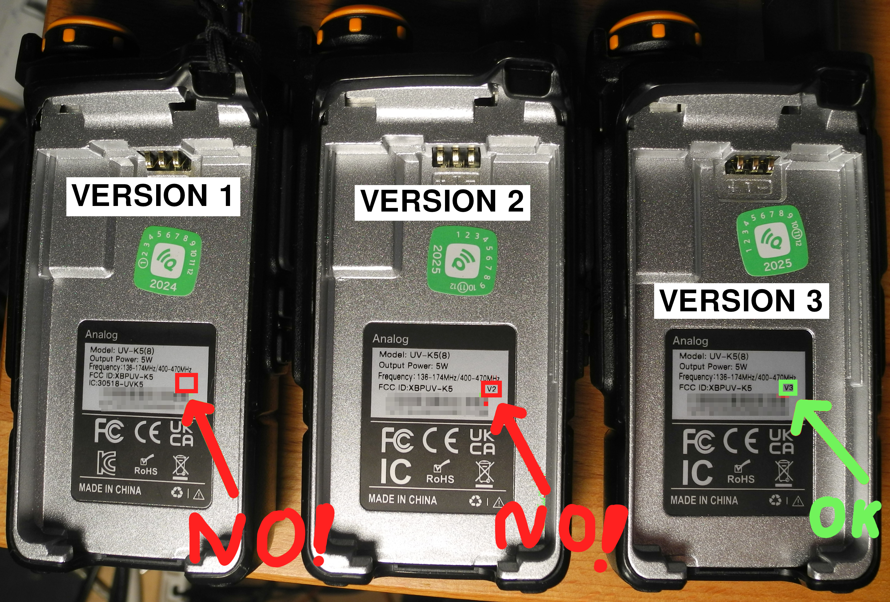

Version 1 devices have no version label, version 2 has "V2", version 3 has "V3" and Software Version 7.x (Menu 53 "VER").

> [!WARNING]
> There are falsely labeled devices out! (Internally V2 but V3 on the label.)
> Please check [this discussion first.](https://github.com/armel/uv-k1-k5v3-firmware-custom/discussions/54)

### This project is for UV-K5 hardware version 3 and UV-K1!
* FCC ID "XBPUV-K5"
* Quansheng UV-K5(8) / UV-K5(99) version 3 :heavy_check_mark:
* Quansheng UV-K1 / UV-K1(8) :heavy_check_mark:
* Download release: [Quansheng UV-Kx firmware with ARDF support for hardware version 3](https://github.com/reald/uv-k1-k5v3-firmware-custom/releases) :heavy_check_mark:


### UV-K5 hardware version 1 needs different firmware:
* FCC ID "XBPUV-K5"
* Quansheng UV-K5 version 1
* Quansheng UV-K5+ ("UV-5R PLUS") version 1
* Quansheng UV-K5(8) version 1 / Quansheng UV-K6 version 1
* Quansheng UV-K5(99) version 1
* Use this project: [Quansheng UV-Kx firmware with ARDF support for hardware version 1](https://github.com/reald/uv-k5-firmware-custom/releases)


### UV-K5 hardware version 2 needs different firmware:
* FCC ID "XBPUV-K5"
* Quansheng UV-K5(8) / UV-K5(99) (with FCC ID "XBPUV-K5") version 2
* Use this project: [Quansheng UV-Kx firmware with ARDF support for hardware version 2](https://codeberg.org/DL9CAT/uv-k5-firmware-custom_v2/releases)


### NOT COMPATIBLE:
* Quansheng TK-11 / TK-11(8) :x:
* Similar looking baofeng radios :x:


## ARDF Feature Manual

Download a precompiled release in the project repository for your [hardware version](#compatible-devices).


## Firmware Flashing

### Preparation with serial programming cable

You need a quansheng programming cable with an integrated USB to serial converter. Most baofeng cables are working fine, too.

1. Find out which hardware version do you have and which firmware do you need for it. See [compatible devices](#compatible-devices).
1. Backup your settings!
1. Charge battery if almost empty!
1. Press PTT key while turning the radio on. This will NOT work if the programming cable is already plugged. White LED on top MUST turn on.
1. Connect the programming cable NOW
1. Run flash program which fits to your hardware version (see next sections)

### Preparation with USB-C cable

Since UV-Kx hardware version 3 the devices can be flashed with a standard USB-C cable, too.

1. Find out which hardware version do you have and which firmware do you need for it. See [compatible devices](#compatible-devices).
1. Connect the USB-C cable
1. Backup your settings!
1. Charge battery if almost empty!
1. Press PTT key while turning the radio on. White LED on top MUST turn on.
1. Run flash program which fits to your hardware version (see next sections)


#### Flash programs for UV-K5/6 hardware version 1
- [HW Version 1 Webflasher for chrome based browsers](https://egzumer.github.io/uvtools/) (Choose `firmware.packed.bin`)
  - :warning: Do NOT flash V2 or V3 hardware devices with this flasher!
- On linux [k5prog](https://github.com/nica-f/k5prog) can be used: Run `k5prog -b firmware.bin -F -YYY`
- On windows [k5prog_win](https://github.com/OneOfEleven/k5prog-win/raw/refs/heads/main/k5prog_win.exe) can be used. (Choose `firmware.packed.bin`)
- Official quansheng flash tool (Windows only. Choose `firmware.packed.bin`)

#### Flash programs for UV-K5/6 hardware version 2
- There is no working webflasher for this hardware version.
- On linux [k5prog](https://github.com/nica-f/k5prog) can be used: Run `k5prog -b UVK5-V2.ARDF.bin -F -YYY`
- On windows [k5prog_win](https://github.com/OneOfEleven/k5prog-win/raw/refs/heads/main/k5prog_win.exe) can be used. (Choose `UVK5-V2.ARDF.packed.bin`)

#### Flash programs for UV-K5/6 hardware version 3 and K1
- Either programming cable or USB-C cable can be used.
- :warning: k5prog and k5prog_win are NOT compatible.
- [UVTOOLS2 for chrome based browsers](https://armel.github.io/uvtools2/)
  - :warning: Do NOT flash V1 or V2 hardware devices with this flasher!

#### Trouble Shooting
- If device does not boot after flashing something went wrong. Try flashing another firmware file or a different flash tool.
- If serial port is not found on linux add your username to the `dialout` group (`sudo usermod -aG dialout your_username`) and reboot.


## Usage

### Draussenfuchs Quick Setup ###

1. Turn the power knob at least 90° to 120° to switch the device on.
1. Draussenfuchs Mode can be enabled in the menu (ARDF = "DF Simple"). This enables **manual gain control**
stepping by pressing **UP/DOWN keys**. Smaller values have lower sensitivity. Use this close to loud transmitters.
"DF Simple" mode automatically preconfigures the most important settings.
1. Set frequency stepping to 1 kHz. (Menu: Step = 1.00kHz)
1. Select amplitude demodulation (Menu: Mode = AM)
1. Enter frequency (Main Screen: 433920 for 433.920 MHz)

That's it.

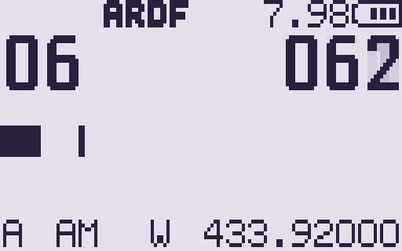

Main screen in "DF Simple" mode. Gain step 6 is used, received signal strength is 062 (the higher the stronger the signal).
A means "VFO A" (can be A or B, does not matter), "AM" means amplitude demodulation (selected in the menu before),
"W" means wide bandwidth (can be "W" or "N", does not really matter). 433.920 is the selected frequency (433.920 MHz).

### ARDF Quick Setup ###

For amateur radio direction finding (ARDF) with timing some more steps are needed:

Turn the power knob at least 90°-120° to switch the device on.

ARDF Mode can be disabled/enabled in the menu (ARDF = OFF / ARDF / DF Simple). "ARDF" or "DF Simple" enable **manual gain control**
stepping by pressing **UP/DOWN keys**. On step changes the attenuation by approximately 5dB. Index 0
has the smallest sensitivity.
"DF Simple" has a simplified display especially created for [Draussenfuchs](https://draussenfuchs.de) or when no timing is needed.

- Disable squelch (Menu: Sql = 0)
- Disable dual watch (Menu: RxMode = MAIN ONLY).
- Select number of foxes in menu "NumFox" (default = 5, min = 1, max = 10; 0 disables fox timing).
- Choose duration time of one fox transmission in menu "FoxDur". Default is 60s.
Modify with UP/DOWN key in 0.1s steps or enter value as *5 digit number* in 1/100s resolution. Confirm with menu button (min = 001.00s, max = 999.99s).
- Enter beep signal before end of fox cycle time (menu "EndSig", 0s = off, 1..30s).
- Adjust clock correction if necessary (menu "ClkCor", details below).
- Activate VFO A (long pressing key "2 A/B" toggles between both VFOs.
- Enter the frequency of the foxes using the number keys. If memory mode is active long press "3 VFO MR" to change to frequency mode.
- Choose the modulation type of the foxes in menu "Mode" (e.g. AM).
- Switch to VFO B by long pressing "2 A/B". This VFO will mostly be used for the return beacon.
- Configure frequency and modulation the same way as for VFO A.
- Change back to VFO A by long pressing "2 A/B".
- If you want to use distance prediction, calibrate RSSI0 at 100m distance (menu "RSS100", details below).

- Unscrew antenna and add a directional antenna with good front/back ratio.
- Select a medium volume and try not to change it. Volume adjustment should be done with gain control (UP/DOWN keys).
- Listen for foxes, synchronize fox number and timer in menu with "ActFox" and "TiRst" options (details below).
- Start hunting foxes and have fun!


#### Main ARDF Screen ####

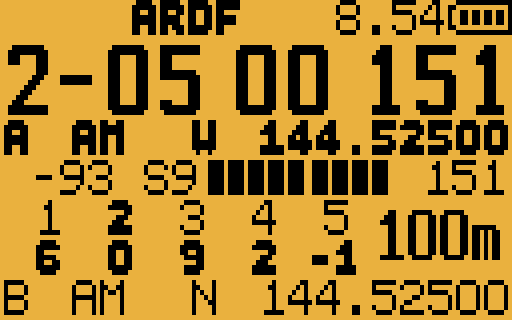

This pictures shows the radio screen if ARDF mode is enabled. The battery voltage is 8.54V. The second (big) line shows
active fox (2), seconds left in this fox cycle (5), chosen gain index (0) and the raw received signal strength indicator (RSSI, 151 here).

The **bold line** below show the settings for the **active VFO**:
VFO "A", demodulation "AM", bandwidth mode "W" (wide) and receiving frequency "144.525 MHz".

In the middle the signal strength is shown: -93 dBm / S9 and a strength bar. The value at the end of the line is called *RSSI0* (151). It is
used for distance calculation and distance calibration. It adds the influence of the selected attenuation (gain index) to the raw RSSI value.

For the active VFO (A) the gain remember mode (details below) is active so the gain index history table for up to 5 foxes is shown. The active fox number is bold.
The last column behind the gain remember table shows a rough prediction of the distance to the fox (100m).
It is roughly estimated out of the normalized signal strength "RSSI0".
If the received signal is too weak no prediction is shown.

The last line shows the configuration for the **inactive VFO**. It is recommended to put the fox settings in VFO A and the return beacon on VFO B.
By long pressing "2 A/B" key can quickly be switched between both configurations.

The manual gain index (attenuation) value can be chosen with UP/DOWN keys. Smaller values mean more attenuation. Use smaller values if you get closer to a transmitter.

Because hardware version 3 has less attenuation dynamic than its predecessors, negative gain indexes were introduced:
  * -1 disables the input LNA and adds 15dB gain
  * -2 disables the input LNA with no gain
  * -3 and -4 tune to the second/third harmonic frequency (if the radio can receive this range)

These methods give you a huge additional attenuation and can be used to prevent overdriving the receiver.
Use this only close to a transmitter if the RSSI value is rising above 200.
Be aware that the radiation pattern of your antenna might be different when receiving harmonics.

On system boot the device starts with active fox number 1 and full duration time left. In menu "ActFox" the active fox can be changed.
The timer can be reset in menu "TiRst". Select "TiRst" with "M"-key, a triangle appears. Another press on "M"-key will reset the timer.
Use this for synchronization. Active fox and timer are shown on the top in the status bar if the menu is opened.

To get a notice if the fox cycle is ending soon a beep sound can be played. The number of seconds for this tone before
the ending of a fox cycle can be configured in menu "EndSig" (1..30s or "off" for no signal). Please read the [headphone section](#headphones)
before activating this feature with headphones.


#### Gain Remember Mode ####
This firmware supports **gain remember** for manual gain control. If gain remember is activated, the
**manual gain index** is handled **for every fox separately**. At the **beginning of a fox cycle** the **last gain
index for this fox** is **restored from the last cycle**. The manual gain index history table for up to 5 foxes is shown
in the lower part of the screen.

If gain remember is **off**, there is only one gain index for all foxes independent from any fox cycle times.
This feature can be **configured for both VFOs separately** (menu "GainRe": Off / VFO A / VFO B / BOTH).

A usage scenario would be to configure the fox frequency on VFO A with gain remember mode on. Put the return beacon
frequency on VFO B without gain remember on. (The return beacon is transmitting permanently so there is no need for
different gains in different time slots.)

You can quickly switch between both VFOs by long pressing "2 (A/B)" or a configured function key (see below).

If gain remember is not activated on the actual VFO or "no timing" is selected (NumFox=0), no gain index history is shown in the lower part of the screen.


#### Fox distance prediction and calibration ####
The distance to the fox is calculated out of a simple model: A change of 30dB in signal strength in a forest is a factor of 10 in distance. This is only
a rough model. The real signal strength highly depends on the topology of the area and can vary a lot especially in hilly areas. So don´t overestimate
the predicted value.

The signal strength highly depends on the real transmitted power of the fox and the antenna at your receiver. To calibrate this combination place yourself
100m away from a transmitting fox. Choose a gain index as low as possible (preferable 0, but NOT negative!). Point your antenna directly to the fox.
Watch the RSSI0 value (right from the signal strength bar, above the predicted distance) if the fox is transmitting its identifier. Enter the
observed peak value in the "RSS100" menu.
If the shown distance values are too low, increase the value of RSS100. If the shown distance values are too high, decrease the value of RSS100.
The resolution is 0.5dB. A value of 0 disables distance prediction completely.


#### Clock Correction ####
The microcontroller of the radio has no crystal oscillator and runs on an internal 48 MHz resonator only.
So all timers in the CPU are not very precise. This leads to a heavily drifting clock.

> [!Note]
> If no timing is used (e.g. in ARDF="DF Simple" mode) clock correction is **not** necessary.

The firmware provides a correction mechanism to reach acceptable ranges.

To find the right correction value

* Set the corretion value to 0 (menu "ClkCor")
* Start ARDF mode
* Stop **how many seconds really pass** until **the radio tells 1 hour is up** (useful settings: NumFox = 10, FoxDur = 60.00s)

The formula for the correction value is:

$$ CorrectionValue = 6000 - (StoppedSeconds * 100)/60 $$

E.g. if the radio finished 60 one minute cycles in 59 min and 36 seconds = 59 * 60 + 36 = 3576s the calculation would be:

$$ CorrectionValue = 6000 - (3576 * 100)/60 = 40 $$

Enter this value in menu "ClkCor" using UP/DOWN keys (allowed range: -500 ... 500). The value is stored in eeprom.


#### Function keys ####
Two different ARDF actions can be mapped to function keys:
* Set manual gain to a medium index value (4). It is recommended to configure "ARDF Set Med.Gain" to short press on F2 key, menu: F2Shrt)
* Enable/Disable ARDF function (e.g. for long press on F1 key / menu: F1Long = "ARDF off/on").

It is recommended to configure "Switch VFO" to F1 short (menu F1Shrt).


#### Chirp ####
A [chirp](https://chirpmyradio.com/projects/chirp/wiki/Home) module is shipped with every firmware release.
The radio (including ARDF settings) can be programmed only with this module and NOT with the standard UV-Kx chirp module.

#### Notes ####
* The lowest possible frequency of the receiver chip is 18 MHz. So this is NOT usable on 80 m.
* In ARDF mode any TX functionality is disabled. However it is recommended to compile with ENABLE_PREVENT_TX=1 to
permanently disable TX. This is done for official releases. ARDF receivers with a builtin TX functionality are not permitted
in official competitions anyway.
* You can glue an arrow on the volume knob to keep the position under control (simply cut a triangle from a sticker).
* It is possible (but not recommended because it is more complicated) to use memory mode instead of frequency mode on each VFO.
If memory mode is active on the current VFO, frequency and memory number are are displayed alternately one after each other.
Number keys change the memory number (enter 3 digits)  and not the frequency. You can switch between memory mode and
frequency mode by long pressing "3 VFO/MR" key.
* If you modify settings in memory mode don´t forget to save them before switching off (menu "ChSave").
* You can long press F/# to lock the keypad. If keypad is locked a small lock symbol in the top status bar is shown.
As result in ARDF mode only manual gain control (with up/down keys) and "Switch VFO" and "ARDF Medium Gain"
on the function keys is possible (if configured, see [Function keys](#function-keys)). So ARDF function is possible but no configuration
changes can be done. This can be useful if preconfigured devices are handed to non experienced users. To unlock the keypad just hold F/# key.

#### Troubleshooting ####
* The gain index history is flickering.
  * Disable dual watch (RxMode = MAIN ONLY).
* Only 3 digits are accepted when entering a frequency.
  * The active channel is in memory mode. Long press "3 VFO MR" to change to frequency mode.
* The entered frequency is modified.
  * Decrease frequency step in menu "Step" to desired channel raster (e.g. 1.00 kHz).
* Chirp does read different channel settings than in my radio.
  * If you changed channel settings on the radio you have to store them first (menu "ChSave").
* Signals are all very low, antenna does not respond to rotation movement.
  * Increase volume knob to 90 degree position or more.
* After activating "DF Simple" and switching back to "ARDF" mode the gain remember table is not shown.
  * Reactivate Fox Timing (NumFox > 1) and Gain Remember (GainRe) for the desired VFO
* UP and Down Keys are swapped on UV-K5 V3.
  * K1 settings are selected. Change menu point "SetNav" from „LEFT RIGHT UV-K1“ to „UP DOWN UV-K5(8)“.
    * Before release 0.4 this had to be done in the hidden menu: Hold PTT and SIDE BUTTON 1️⃣ and switch the device on. Release both keys. Change "SetNav" Settings. Restart device.
* Uploading configuration to radio fails in chirp ("Header short read")
  * Try different USB-C cables and different USB ports.


## Headphones

Headphones can be connected to the 2.5mm jack. The audio signal is between the tip and sleeve of the jack, but
there are some limitations:

> [!WARNING]
> **There is a DC voltage of around 4V (half battery voltage) between tip and sleeve**. Use a DC blocker before connecting your headphones to the device!
> Your **headphones might be destroyed** otherwise!

To make it even worse the DC voltage is switched off and on when playing signal tones (fox cycle end warning beep). This leads to
voltage peaks and crackling noises in your headphones.

Use a DC blocking capacitor for removing the DC voltage from the audio signal:
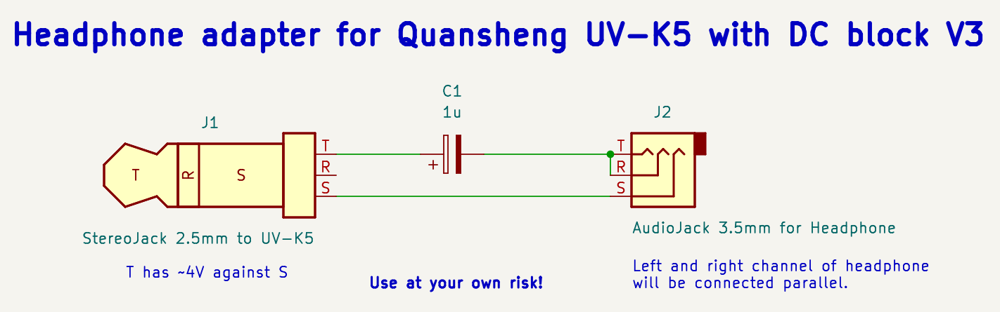

Both headphone channels are connected in parallel. The needed capacity depends on your headphones.
Try inline capacitor values of 0.1uF .. 10uF as a start. For my 8 ohms (2x 16 ohms parallel) headphones
1 uF works quite well.

> [!Warning]
> Use cheap headphones or some you can go without only!!!

> [!TIP]
> A kenwood connector with a combined 2.5 and 3.5mm plug is mechanically more stable than a single 2.5mm stereo plug.

> [!TIP]
> Kenwood connectors with spiral cable can be taken from cheap external baofeng microphones.

> [!TIP]
> Experienced people in SMD soldering can add the capacitor [inside the device](https://github.com/ludwich66/Quansheng_UV-K5_Wiki/wiki/Hardware_Mods#5-fix-power-failure-with-external-handset-warming-speaker-with-dc-on-output-or-unwanted-busy-channel-lockout-effect-on-external-ptt).
> With this modification a normal 2.5mm stereo plug to 3.5mm stereo jack adapter cable is sufficient.


## Antenna proposals

### 3 Element Yagi for 2m by DK7ZB

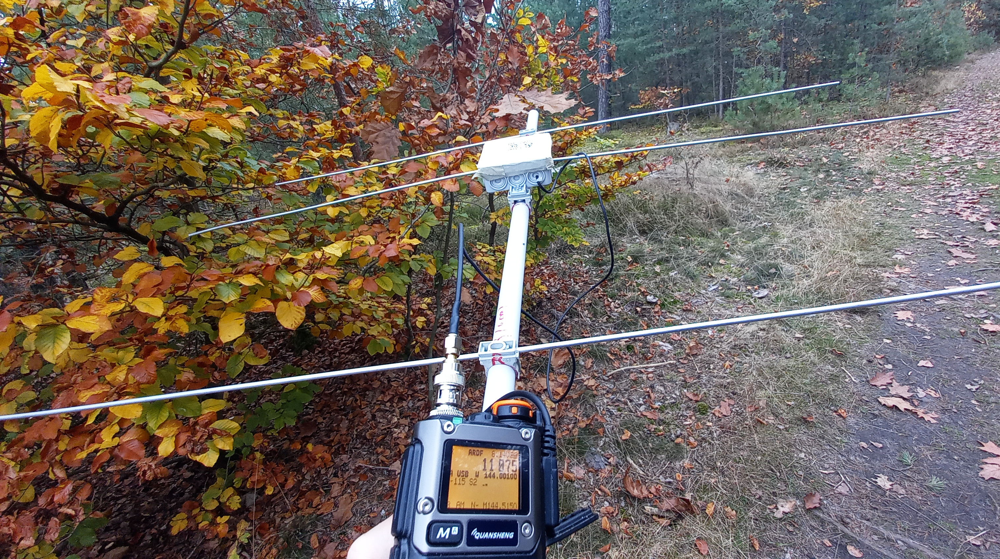
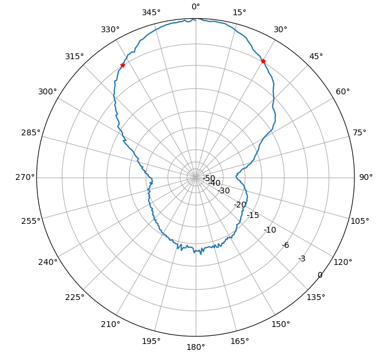

Pro: Very easy and fast to build, tolerant, very good SWR, light weight, cheap.

Cons: Front to back ratio not optimal (but not bad!), radials move on boom if not secured.

| Element | Length | Position |
| --- | --- | --- |
| Reflector | 103.9cm | 0 cm |
| Radiator | 102 cm | 30 cm |
| Director | 92,6 cm | 47 cm |

[Build instructions by DK7ZB](https://www.qsl.net/dk7zb/PVC-Yagis/3-Ele-2m.htm)


### 3 Element Tape Measure Antenna for 2m ARDF


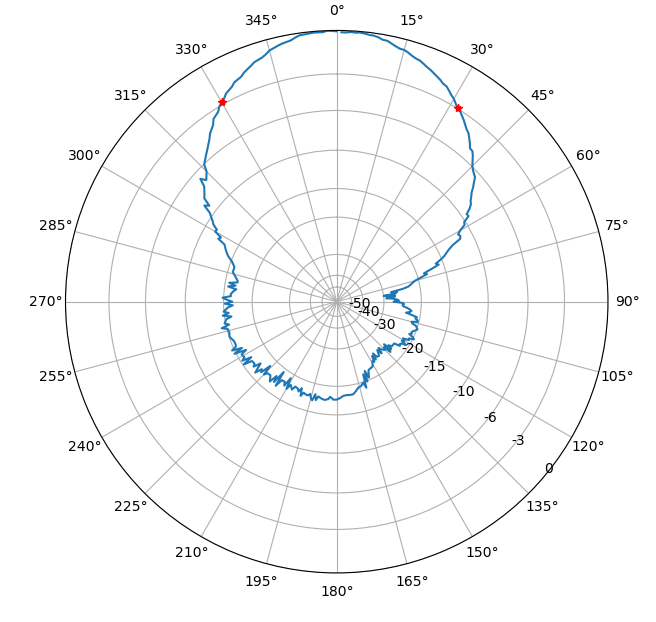

Pro: Better front to back ratio, flexible elements better when running in the fields. Standard ARDF antenna!

Cons: More complex to build, not suitable for TX because of missing adaption.

Tip: Use 2 layers of tape measure. Outer 25cm can be single layer.

| Element | Length | Position |
| --- | --- | --- |
| Reflector | 106.5cm | 0 cm |
| Radiator | 2*47cm | 20 cm |
| Director | 90,5 cm | 52 cm |

#### 3D printed Mechanical solution by DL7CR ####
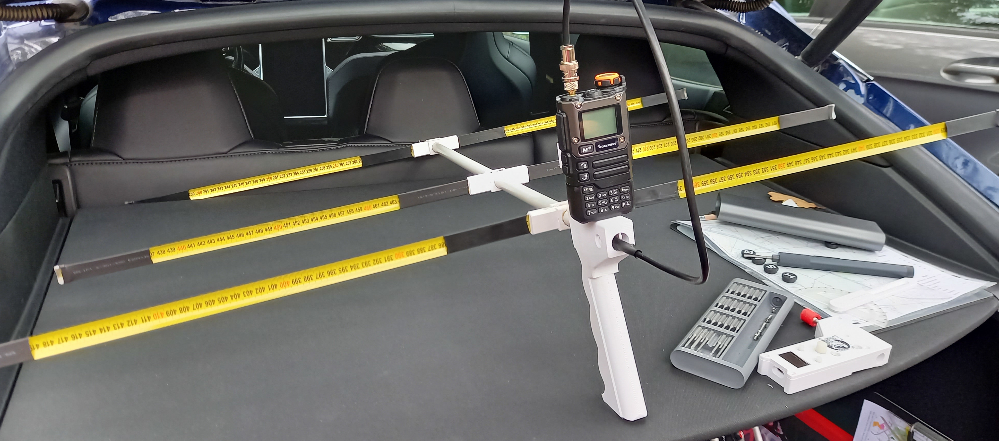

Pro: Comfortable 3D printed solution with 16mm PCV pipe.

Cons: Pressing buttons needs 2 hands

Uses [pawsay stub](https://www.dg7ybn.de/Symmetrising/Symmetrising.htm#Pawsey_Stub_Symmetrising_Device) as balun.

Download [Freecad model here](images/ARDF2_Ant.FCStd).


### 3 Element Tape Measure Yagi for 70 cm
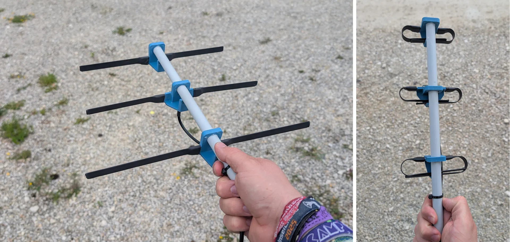
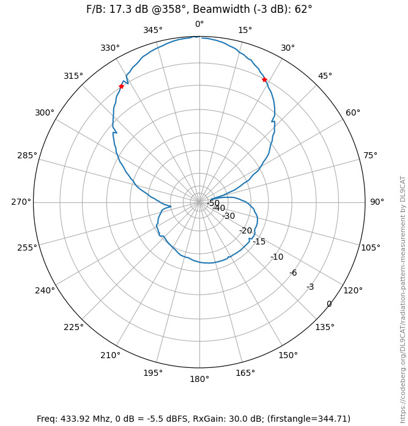


Made out of 12mm tape measure. Designed for Draussenfuchs Project.

Pro: Very good F/B ratio, light weight (70g), cheap, foldable.

[3d printed parts available here.](https://www.printables.com/model/1757409-3-element-yagi-direction-finding-antenna-for-70cm)

| Element | Length | Position |
| --- | --- | --- |
| Reflector | 34.6 cm | 0 cm |
| Radiator | 30 cm | 12 cm |
| Director | 28 cm | 23 cm |


### 3 Element Yagi for 70 cm
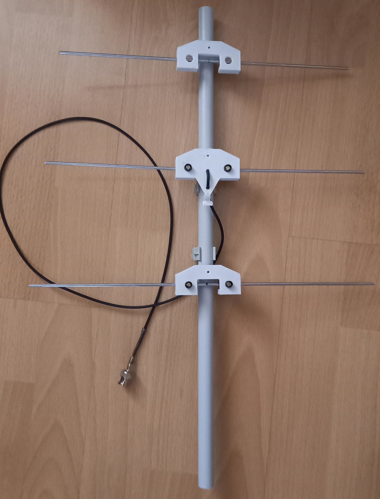
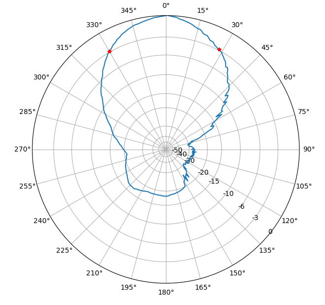

Made out of 3.2mm welding rods.

Pro: Quite nice F/B ratio, light weight.

Cons: Thin rods not so suitable for younger children.

| Element | Length | Position |
| --- | --- | --- |
| Reflector | 35 cm | 0 cm |
| Radiator | 32,6 cm | 12 cm |
| Director | 30 cm | 23 cm |


### 3 Element Tape measure Yagi for 70 cm (DF9NX)
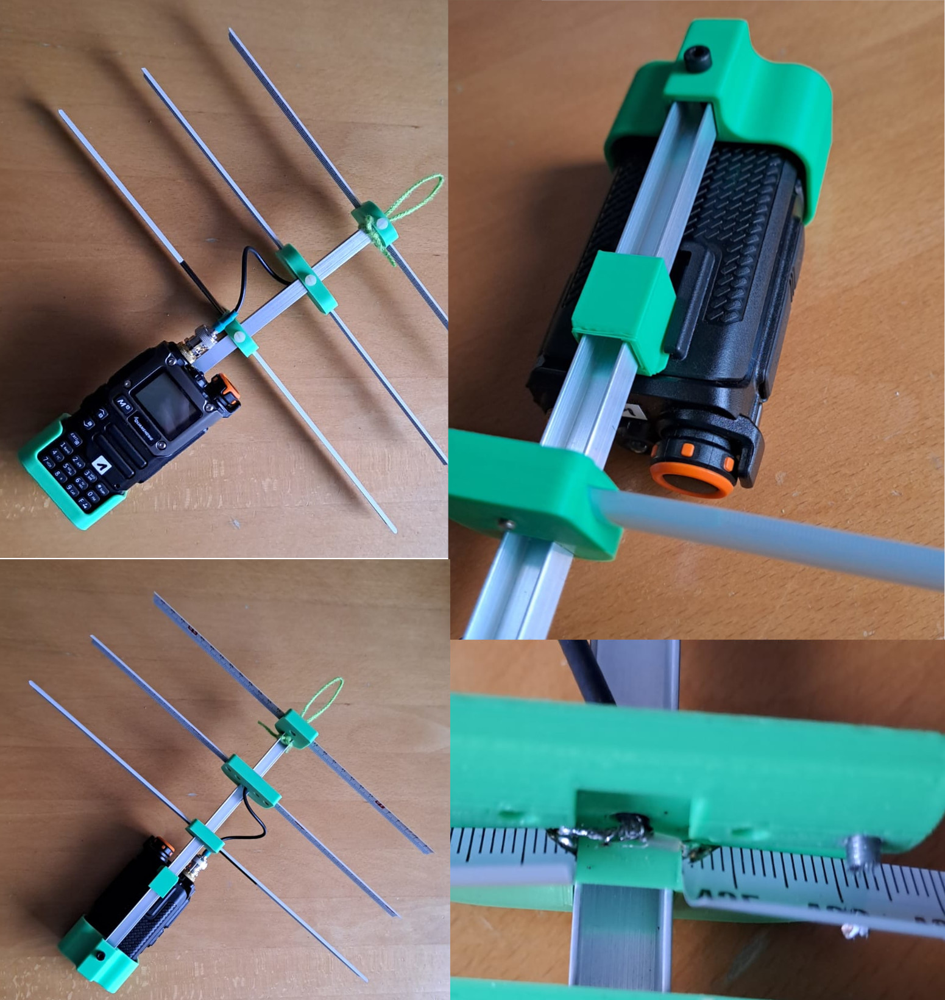

[3d printed mounts](https://github.com/reald/uv-k5-firmware-custom/raw/refs/heads/main/images/df9nx_70cm_3dfiles.zip) for tape measure elements (19mm) on 10mm aluminium u-profile.
Driven simply in center of radiator. RG174 cable and M3x12mm screws.

Pro: Radio and antenna combined.

Cons: Not for TX.

| Element | Length | Position |
| --- | --- | --- |
| Reflector | 34 cm | 0 cm |
| Radiator | 32,5 cm | 12.6 cm |
| Director | 29.5 cm | 18 cm |


### 3 Element cable Yagi for 70 cm (DF9NX)
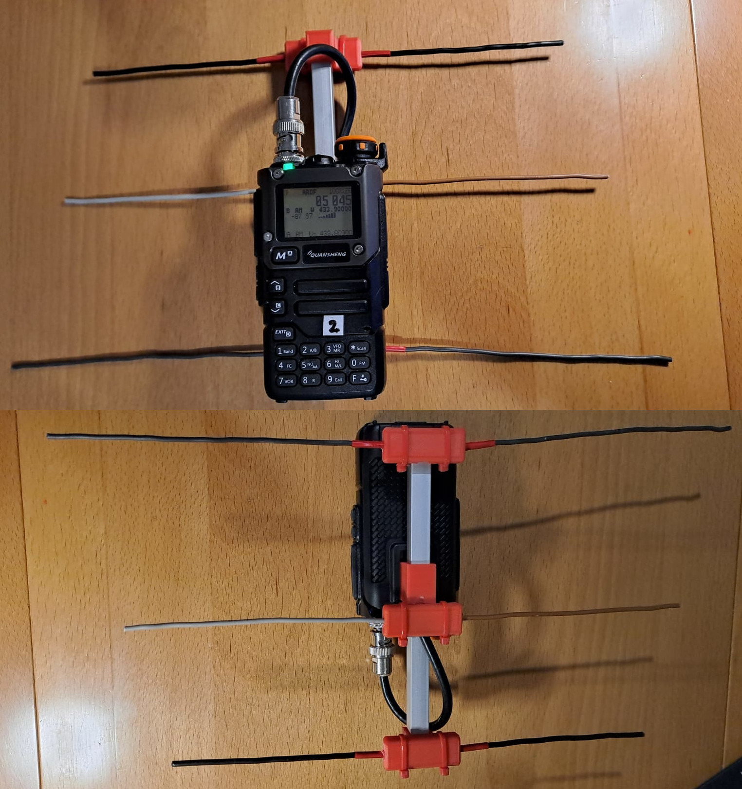

[3d printed mounts](https://github.com/reald/uv-k5-firmware-custom/raw/refs/heads/main/images/df9nx_yagi_cable_3dfiles.zip) for electric cable elements on 10mm aluminium u-profile.
Driven simply in center of radiator.

Pro: Radio and antenna combined, very light weight.

Cons: Not for TX, elements might bend.

| Element | Length | Position |
| --- | --- | --- |
| Reflector | 38 cm | 0 cm |
| Radiator | 30 cm | 8.5 cm |
| Director | 27 cm | 14 cm |


### Combined 2m / 70cm Antenna by PA0JBG

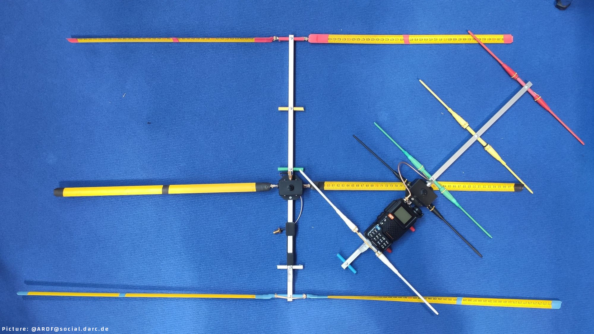

Notes: This prototype has a switchable attenuator (approx. 25dB), this is optional. Boom is made of electrical conducting material.

2 m:
| Element | Length | Position |
| --- | --- | --- |
| Reflector | 106 cm | 0 cm |
| Radiator | 94 cm | 20 cm |
| Director | 90 cm | 51.5 cm |

70 cm:
| Element | Length | Position |
| --- | --- | --- |
| Reflector | 34,8 cm | 0 cm |
| Radiator | 31 cm | 14,5 cm |
| Director 1 | 30,2 cm | 19 cm |
| Director 2 | 29,8 cm | 31,5 cm |
| Director 3 | 29,2 cm | 46 cm |


### Other

- [3D printed 3 element draussenfuchs yagi by DG1JAN](https://www.printables.com/model/1698556-draussenfuchs-yagi)
- [Yet Another Shitty Draussenfuchs Antenna by DN9PSC](https://codeberg.org/casartar/YAS-Draussenfuch-Antenna)


# A note for developers who intend to fork this project

This firmware is distributed under the Apache 2.0 License, carrying forward the original copyright of DualTachyon, whose work laid the foundation for the UV-K5 open-source ecosystem.
If you create a fork or a derived version, **we strongly encourage you to keep your work open source**.

Keeping your fork open:

- aligns with the intent and spirit of the Apache 2.0 License
- supports the amateur-radio and embedded-development community
- avoids unnecessary fragmentation
- allows others to study, audit and improve the firmware

It is also very much in line with the **ham spirit**: sharing knowledge, experimenting together and helping each other, rather than closing things off or claiming them as your own.

Maintaining an open-source fork is the best way to help build a healthy and sustainable ecosystem for everyone.

> [!WARNING]
> Use this firmware at your own risk (entirely). There is absolutely no guarantee that it will work in any way shape or form on your radio(s), it may even brick your radio(s), in which case, you'd need to buy another radio.
Anyway, have fun.

> [!CAUTION]
> EN - I recommend to backup your calibration data with [uvtools2](https://armel.github.io/uvtools2/) just after flashing this firmware. It's a good reflex to have. 


## Radio performance

Please note that the Quansheng UV-Kx radios are not professional quality transceivers, their
performance is strictly limited. The RX front end has no track-tuned band pass filtering
at all, and so are wide band/wide open to any and all signals over a large frequency range.

Using the radio in high intensity RF environments will most likely make reception anything but
easy (AM mode will suffer far more than FM ever will), the receiver simply doesn't have a
great dynamic range, which results in distorted AM audio with stronger RX'ed signals.
There is nothing more anyone can do in firmware/software to improve that, once the RX gain
adjustment I do (AM fix) reaches the hardwares limit, your AM RX audio will be all but
non-existent (just like Quansheng's firmware).
On the other hand, FM RX audio will/should be fine.

But, they are nice toys for the price, fun to play with.

## Compiling and Building from Docker

This project provides a Docker-based build system to compile all firmware editions for the UV-K1 and UV-K5 V3. Everything is handled through the `compile-with-docker.sh` helper script.

All build outputs are generated inside the `build/<Preset>` directory, according to the CMake presets defined in `CMakePresets.json`.

### Prerequisites

- Docker installed on your system
- Bash environment (Linux, macOS, WSL, Git Bash on Windows)

### Build Script Overview

The script `compile-with-docker.sh` performs the following actions:

1. Builds the Docker image (`uvk1-uvk5v3`) if it does not already exist.
2. Removes any previous `build` directory to ensure a clean configuration.
3. Runs CMake using the selected preset inside the Docker container.
4. Builds the firmware and outputs `.elf`, `.bin` and `.hex` files for the chosen edition.

### Usage

```bash
./compile-with-docker.sh <Preset> [extra CMake options]
```

### Available Presets

- **ARDF**
- **Custom**
- **Bandscope**
- **Broadcast**
- **Basic**
- **RescueOps**
- **Game**
- **Fusion**
- **All** (builds all editions sequentially)

### Examples

Build a single edition:

```bash

./compile-with-docker.sh ARDF
./compile-with-docker.sh Fusion
./compile-with-docker.sh Bandscope
./compile-with-docker.sh Broadcast
```

Build everything:

```bash
./compile-with-docker.sh All
```

### Passing Additional CMake Options

You can pass extra configuration options after the preset name.  
These are forwarded directly to `cmake --preset` inside the container.

Examples:

```bash
./compile-with-docker.sh Bandscope -DENABLE_SPECTRUM=ON
./compile-with-docker.sh Broadcast -DENABLE_FEAT_F4HWN_GAME=ON -DENABLE_NOAA=ON
./compile-with-docker.sh Bandscope -DSQL_TONE=600
```

### Notes

- The first run may take a few minutes while Docker builds the base image.
- Running with `All` will build every firmware variant in sequence.
- Each build runs inside Docker, so your host environment remains clean.

## Flashing the Firmware with UVTools2

You can flash the UV-K5 V3 and UV-K1 directly from your web browser using the cross-platform WebSerial-based [UVTools2](https://armel.github.io/uvtools2/).

It works on Chrome, Chromium and Edge (desktop versions), and does not require installing any driver or software on your computer.

## Steps to flash the firmware

- Open UVTools2 in [flash](https://armel.github.io/uvtools2/?mode=flash) mode (or click the Flash Firmware tab).
- Connect your radio to your computer using a compatible USB programming cable (USB-C or Baofeng/Kenwood like double jack USB cable).
- Make sure your radio is in **DFU mode (flash mode)**.
- Select the firmware .bin file on your computer. 
- Click on `Flash Firmware`, then select the serial port associated with your radio.
- The progress bar will guide you through the flashing steps.

Once finished, your radio restart with the new firmware.

## Steps to dump or restore calibration data

[UVTools2](https://armel.github.io/uvtools2/) can also dump and restore calibration data, which is highly recommended. It’s best to create a dump right after installing F4HWN firmware, and to restore it before installing another firmware (or when returning to the stock firmware, for example).

### Dump

- Open UVTools2 in [dump](https://armel.github.io/uvtools2/?mode=dump) mode (or click the Dump Calib tab).
- Power on your radio in **normal mode**.
- Click `Dump Calibration Data`.

When the process is complete, click `Download calibration.dat` to save the file to your computer.

> [!NOTE]
> A good practice is to rename your calibration file using the serial number of your radio, which you can find on the label on the back of the device once you remove the battery. This helps avoid mixing up calibration files when you own multiple units.

### Restore

- Open UVTools2 in [restore](https://armel.github.io/uvtools2/?mode=restore) mode (or click the Restore Calib tab).
- Power on your radio in **normal mode**.
- Select your calibration.dat file on your computer.

Click `Restore Calibration Data` and wait until the process fully completes.

## Credits

Many thanks to various people:

* [Armel](https://github.com/armel/)
* [Muzkr](https://github.com/muzkr)
* [Andrej](https://github.com/Tunas1337)
* [Egzumer](https://github.com/egzumer)
* [OneOfEleven](https://github.com/OneOfEleven)
* [DualTachyon](https://github.com/DualTachyon)
* [Mikhail](https://github.com/fagci)
* [Manuel](https://github.com/manujedi)
* @wagner
* @Lohtse Shar
* [@Matoz](https://github.com/spm81)
* @Davide
* @Ismo OH2FTG
* [OneOfEleven](https://github.com/OneOfEleven)
* @d1ced95
* and others I forget

## License

Copyright 2023 Dual Tachyon
https://github.com/DualTachyon

Licensed under the Apache License, Version 2.0 (the "License");
you may not use this file except in compliance with the License.
You may obtain a copy of the License at

    http://www.apache.org/licenses/LICENSE-2.0

    Unless required by applicable law or agreed to in writing, software
    distributed under the License is distributed on an "AS IS" BASIS,
    WITHOUT WARRANTIES OR CONDITIONS OF ANY KIND, either express or implied.
    See the License for the specific language governing permissions and
    limitations under the License.
